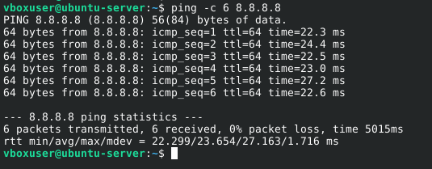
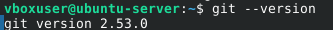
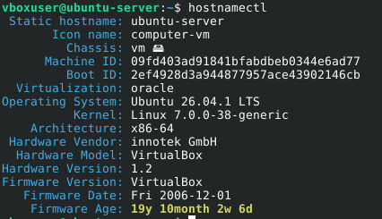
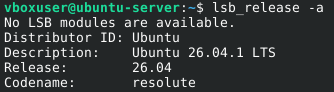
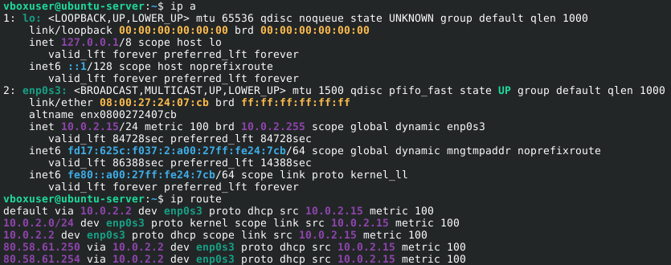
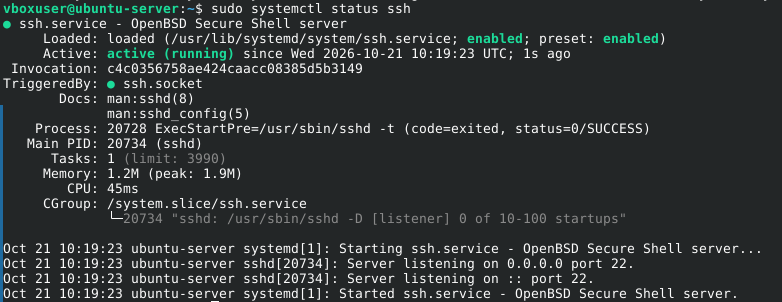
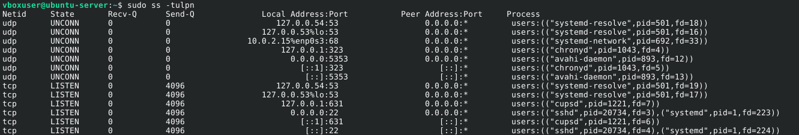
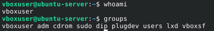
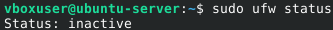
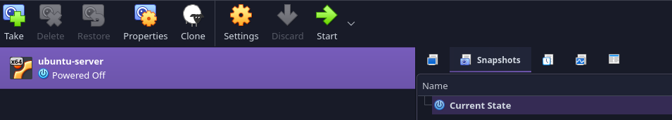

# Configuration of your server
> Álvaro Fernández Barrero, 2º DAW BIL

## Setting the machine up to date

When it is required to configurate a machine, the first thing to do it to check if it has connection to Internet because we are likely about to be installing a few programs. Thus, an easy way to do that is by running the command `ping`, which simulates sending the information to a specific device by its ID and shows whether the connection was possible.



As we see in the picture, we could connect to the device whose IP is 8.8.8.8, a device provided by Google.

Next, we need to ensure all our packages are updated by running the following commands:

```sh
sudo apt update
sudo apt upgrade -y
``` 
And finally, we reboot the machine running the command:

```sh
sudo reboot
```

## Installing programs

Now that our machine is up to date, we will install the following packages:

* **curl**: Data transfer
* **wget**: Tool to download files from internet
* **git**: Program to control the versions of the projects
* **vim**: Text editor
* **nano**: Text editor
* **unzip**: Files extractor
* **tree**: Program to see all the files inside a given directory in a tree-shape
* **net-tools**: Collection of network utilities
* **htop**: An interactive process monitor that displays CPU, RAM usage and running processes

```sh
sudo apt install curl wget git vim nano unzip tree net-tools htop
```

The most important one here now is git, so it is interesting to check if it was successfully installed:

```sh
git --version
```



## Operating system and Ubuntu version

Next, we will check the machine's hostname by writing `hostnamectl`:



And, with the command `lsb_release -a`, we can check information about the Ubuntu.



## Checking network connection && SSH

Furthermore, we will check the network settings by running the commands:

```sh
ip a
ip route
```



For the SSH, in case it is not already install we just have to run the command:

```sh
sudo apt install -y openssh-server # Installs SSH
sudo systemctl enable --now ssh # Enables SSH
```

And to check its status we write:

```sh
sudo systemctl status ssh
```



Once we have the SSH running, we can use another command to see the ports that are being in used:

```sh
sudo ss -tulpn
```



## Users & groups

Bash counts with a couple of commands to see the user being used and the groups created in the machine with:

```sh
whoami
groups
```



## Firewall

Configuring the firewall is key to allow other devices to access to the machine.

First we check the firewall's status:

```sh
sudo ufw stats
```



We require the firewall to allow SSH to connect with external devices.

```
sudo ufw allow ssh
```

And enable the firewall.

```
sudo ufw enable
```


## Snapshot

We now will save these settings in a snapshot, a kind of backup to access in case the machine gets corrupted so we do not have to make all these steps again.

For that, we shut the device down.

```sh
sudo shutdown now
```

Secondsly, in virtualbox, go to the *"Snapshot"* section and click on *"Take"*.



After setting a name, we have a snapshot finally made.
