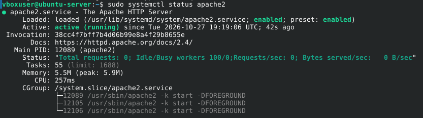
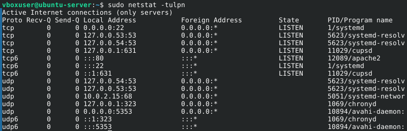
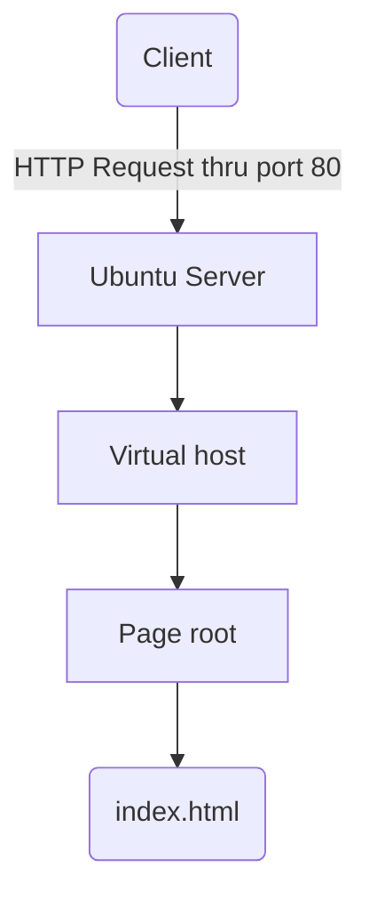

# Installing Apache in Ubuntu Server
> Álvaro Fernández Barrero, 2º DAW BIL

When we require to use a web server, first we need to install it typically on a linux-based operating system. For that, we run the following commands:


```sh
sudo apt update
sudo apt upgrade -y
sudo apt install apache2
```

To check if the commands installed the server properly, we can additionally run the following:

```sh
sudo systemctl status apache2
```

If the server is installed and the server is running, we should see "Active" somewhere in the printed result. If not, the message show should that either the server is not installed or running.

To start the server in case it is not active, we just have to run the command:

```sh
sudo systemctl start apache2
```

If we now run the following command we will see if the service is enabled.

```sh
sudo systemctl is-enabled apache2
```



Furthermore, to check the port being used by apache, we can list all ports being used by writing:

```sh
sudo netstat -tulpn
```



In the field *"PID/Program name"*, there is a 12089/apache2 section, which is in "LISTEN" state (meaning that is running and waiting for something to act upon). It uses TCP and the port 80.

After it all, the architecture we have achieved is the following:


