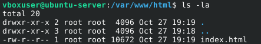
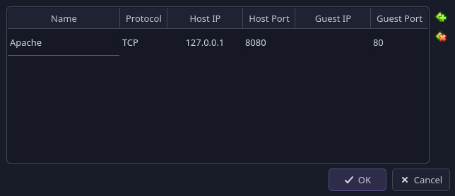
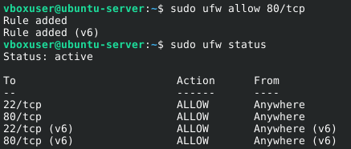
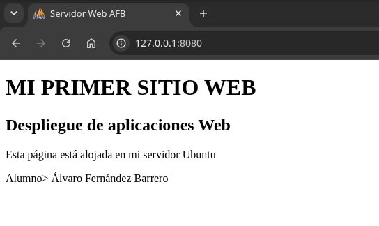

# First page deployed
> Álvaro Fernández Barrero, 2º DAW BIL

Once apache is successfully installed in our linux machine, we will start working on a simple page deplyed on it thus we can access to it using a different device.

Apache takes the page saved in a specific directory /var/www/html. If we list the elements inside it:



There is an *index.html* which is the one that will open when we access to the page deployed on the server. We can modify it to have whatever we want it to contain.

Then, we need to add the port to the machine and enable it running a couple of commands.

```sh
sudo ufw allow 80/tcp
sudo ufw status
```




We need to ensure apache is running a working properly indeed before we do anything else. Otherwise nothing will work.

```sh
sudo systemctl start apache2
```


