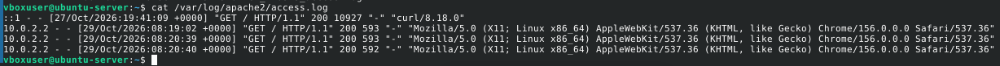
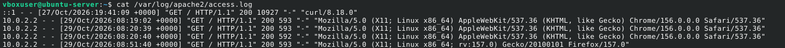

# Checking server logs
> Álvaro Fernández Barrero, 2º DAW BIL

When working with Ubuntu server and apache, there is a file /var/log/apache2/access.log that contains the information of all devices that connected to the server and information about them.

If we access to the web page again, we will see a new register with its user agents.

