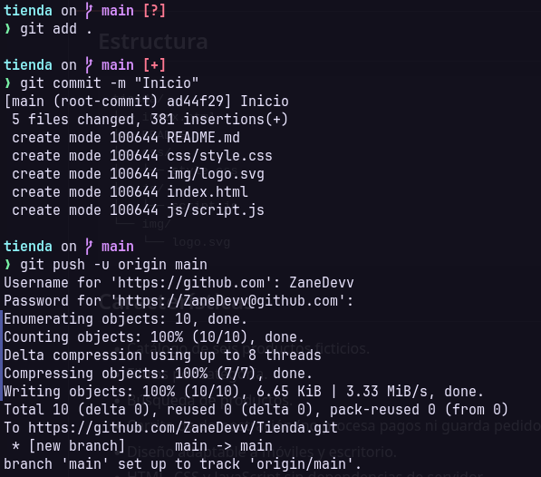
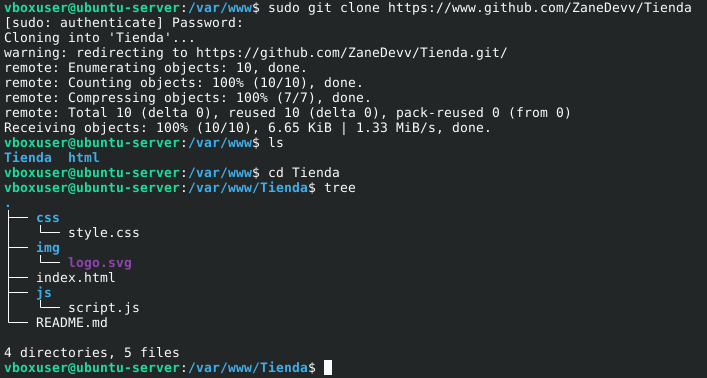
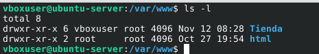
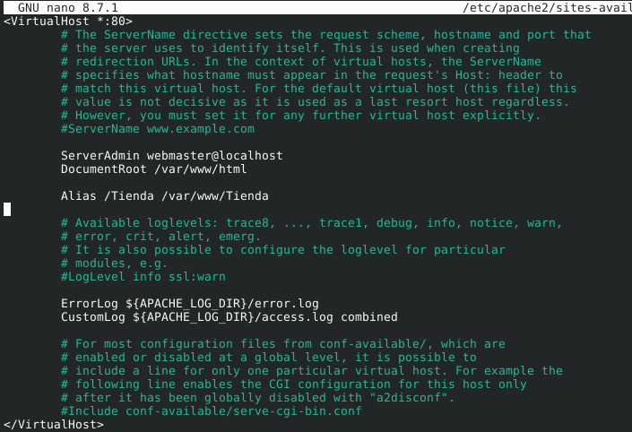
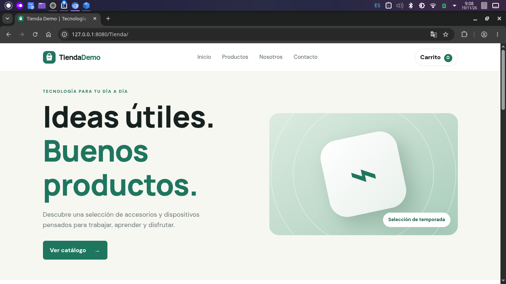

# Tienda Demo
> Álvaro Fernández Barrero, 2º DAW BIL

In order to deploy the given web page, the simplest first way to have it in several devices is by uploading it to GitHub.



We would require to have indeed a repository previously created on GitHub. In my case, you can find it here: https://github.com/ZaneDevv/Tienda

As this repository contains the files the the page needs, we can clone this repository in a different device.



Now, we need to ensure that the directory has que permissions enough for the task.



In the file /etc/sites-available/000-default.conf we also need to allow this new directory to be accesible. For that, we just have to write:

```sh
Alias /Tienda /var/www/Tienda
```

Where the first parameter refers to the URL after the server's domain and /var/www/Tienda to where the files are placed.



After that, we just require to restart apache2 by running:

```sh
sudo systemctl restart apache2
```
Now, if we attempt to visualize this webpage outside this virtual machine, we must be able to access to it.


