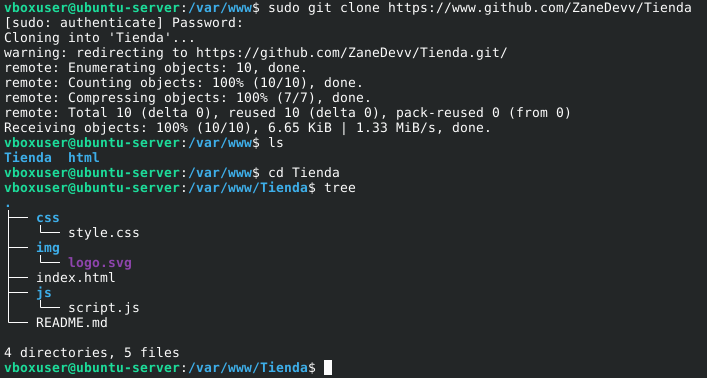

# Tienda Demo
> Álvaro Fernández Barrero, 2º DAW BIL

In order to deplpoy the given web page, the simplest first way to have it in several devices is by uploading it to GitHub.

We would require to have indeed a repository previously created on GitHub.

As this repository contains the files the the page needs, we can clone this repository in a different device.

